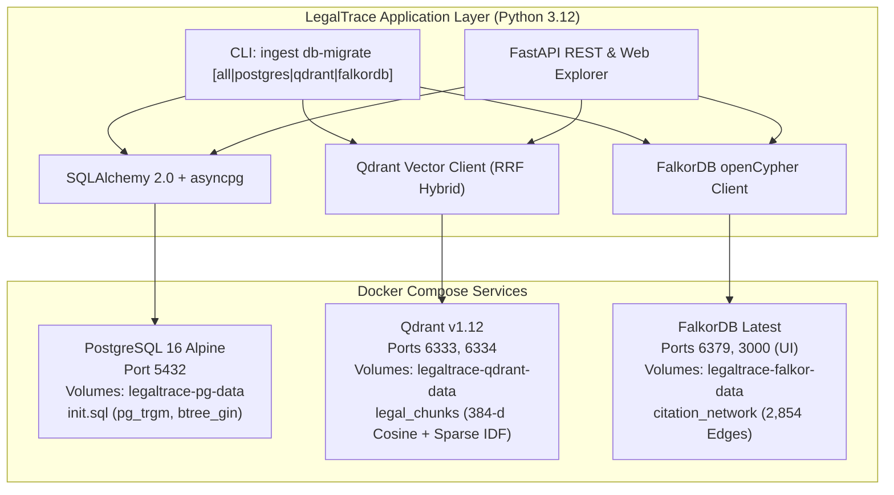

# Phase 2 Implementation Walkthrough: Database Infrastructure

> **Status**: Completed & Verified (125/125 tests passing)  
> **Repository**: [LegalTrace](https://github.com/akshata-patel30/LegalTrace)  
> **Commit**: `5f0c5a5` ("feat: Implement Phase 2 database infrastructure (PostgreSQL, Qdrant, FalkorDB, Docker)")

---

## 1. Overview of Delivered Components

Phase 2 replaces the initial file-backed storage (JSON/Parquet/NumPy) with an enterprise-grade persistent database architecture orchestrated via Docker Compose:



---

## 2. Source Code & Infrastructure Changes

### 2.1 Docker Orchestration
- [`docker-compose.yml`](file:///D:/Timepasss/ingestion-source/docker-compose.yml): Configured services for `postgres` (16-alpine), `qdrant` (v1.12.6), and `falkordb` (latest) with persistent volumes, network bridges, and health checks.
- [`docker/postgres/init.sql`](file:///D:/Timepasss/ingestion-source/docker/postgres/init.sql): Auto-provisions `pg_trgm` and `btree_gin` extensions for fast legal text and JSON indexing.
- [`Dockerfile`](file:///D:/Timepasss/ingestion-source/Dockerfile): Multi-stage container build with Python 3.12-slim and system libraries (`libpq5`, `curl`).
- [`.dockerignore`](file:///D:/Timepasss/ingestion-source/.dockerignore): Optimized build context exclusion rules.

### 2.2 Relational Layer (PostgreSQL)
- [`src/ingestion_source/db/session.py`](file:///D:/Timepasss/ingestion-source/src/ingestion_source/db/session.py):
  - `init_db(database_url)`: Initializes the async engine with connection pooling and pre-ping checks.
  - `get_db()`: Async generator for FastAPI dependency injection with automatic transaction commit/rollback.
  - `create_tables()` & `close_db()`: Lifecycle functions for schema management and pool disposal.
- [`src/ingestion_source/db/models.py`](file:///D:/Timepasss/ingestion-source/src/ingestion_source/db/models.py):
  - `Judgment`: Core court decision record (case metadata, header, bench, dockets, parties, disposition, domain, full-text).
  - `Chunk`: 9,167+ semantic chunks linked via 1:N cascade with composite role index `ix_chunks_role_doc`.
  - `Headnote`: Automated syllabi, catchwords, brief facts, issues, ratio decidendi, and operative holdings.
  - `StatuteMention`: Act names, codes, and sections referenced.
  - `SearchSession` & `RAGSession`: Audit logging for queries, retrieval latency, and query plans.

### 2.3 Vector Layer (Qdrant)
- [`src/ingestion_source/db/vector_store.py`](file:///D:/Timepasss/ingestion-source/src/ingestion_source/db/vector_store.py):
  - Collection `legal_chunks` configured with 384-dimensional dense vectors (Cosine distance) and named sparse vectors with IDF modifier.
  - Deterministic positive int64 point IDs via `chunk_id_to_point_id()`.
  - Batch upserting in windows of 100 points.
  - Hybrid RRF (Reciprocal Rank Fusion) search via Qdrant's native Prefetch queries with dense fallback.
  - Payload filtering on `rhetorical_role`, `court`, `year`, and `legal_domain`.

### 2.4 Graph Layer (FalkorDB)
- [`src/ingestion_source/db/graph_store.py`](file:///D:/Timepasss/ingestion-source/src/ingestion_source/db/graph_store.py):
  - openCypher index creation on `(:Judgment.doc_id)` and `(:Precedent.precedent_id)`.
  - Bulk ingestion from `citation_edges.jsonl` and `precedent_nodes.jsonl` creating `(:Judgment)-[:CITES]->(:Precedent)` relationships with treatment labels (`relied_upon`, `followed`, `distinguished`, `overruled`, `cited`).
  - `get_precedent_treatment()`: Shepardization query for judicial history and good-law verification.
  - `get_top_authorities()`: In-degree citation authority ranking.
  - `find_common_authorities()`: Multi-judgment co-citation discovery.

### 2.5 Migration Engine & CLI
- [`src/ingestion_source/db/migrate.py`](file:///D:/Timepasss/ingestion-source/src/ingestion_source/db/migrate.py):
  - `migrate_postgres()`: Ingests judgments, chunks, headnotes, and statutes.
  - `migrate_qdrant()`: Loads `dense_vectors.npy` and `chunks.json` into Qdrant.
  - `migrate_falkordb()`: Loads directed edges and landmark nodes into FalkorDB.
  - `migrate_all()`: Master orchestrator.
- [`src/ingestion_source/cli.py`](file:///D:/Timepasss/ingestion-source/src/ingestion_source/cli.py):
  - New Typer CLI command: `ingest db-migrate [all|postgres|qdrant|falkordb]`.

---

## 3. Test Suite Verification

Four new test modules were added covering 17 distinct scenarios:

| Test File | Scenarios Tested | Status |
|-----------|------------------|--------|
| [`tests/test_db_models.py`](file:///D:/Timepasss/ingestion-source/tests/test_db_models.py) | Judgment/Chunk/Headnote/Statute CRUD, foreign key cascades, Search & RAG session logging | ✅ PASSED |
| [`tests/test_vector_store.py`](file:///D:/Timepasss/ingestion-source/tests/test_vector_store.py) | Deterministic point hashing, collection creation, batch upserting, hybrid RRF prefetch, fallback, collection deletion | ✅ PASSED |
| [`tests/test_graph_store.py`](file:///D:/Timepasss/ingestion-source/tests/test_graph_store.py) | Canonical citation normalization, index creation, Shepardization treatment lookup, top authority rankings, co-citation paths, graph statistics | ✅ PASSED |
| [`tests/test_migrate.py`](file:///D:/Timepasss/ingestion-source/tests/test_migrate.py) | In-memory PostgreSQL migration pipeline, mocked Qdrant vector loading, mocked FalkorDB openCypher batching | ✅ PASSED |

### Full Test Suite Results
```
================= 125 passed, 7 warnings in 83.55s (0:01:23) ==================
```
- **108** Pipeline A tests passing
- **17** Phase 2 Database Infrastructure tests passing
- **Total**: **125/125** tests passing with zero failures.

---

## 4. How to Use in Production & Development

### 4.1 Launch Databases with Docker Compose
```powershell
# In D:\Timepasss\ingestion-source
docker compose up -d
```
Service endpoints will be available at:
- **PostgreSQL**: `localhost:5432` (`user: legaltrace`, `db: legaltrace`)
- **Qdrant Vector DB**: `http://localhost:6333` (Web Dashboard: `http://localhost:6333/dashboard`)
- **FalkorDB Graph DB**: `localhost:6379` (Web Browser UI: `http://localhost:3000`)

### 4.2 Populate Databases from Existing Corpus
```powershell
# Populate all three databases in one command:
.venv\Scripts\python.exe -m ingestion_source.cli db-migrate all

# Or migrate individual targets:
.venv\Scripts\python.exe -m ingestion_source.cli db-migrate postgres
.venv\Scripts\python.exe -m ingestion_source.cli db-migrate qdrant
.venv\Scripts\python.exe -m ingestion_source.cli db-migrate falkordb
```
